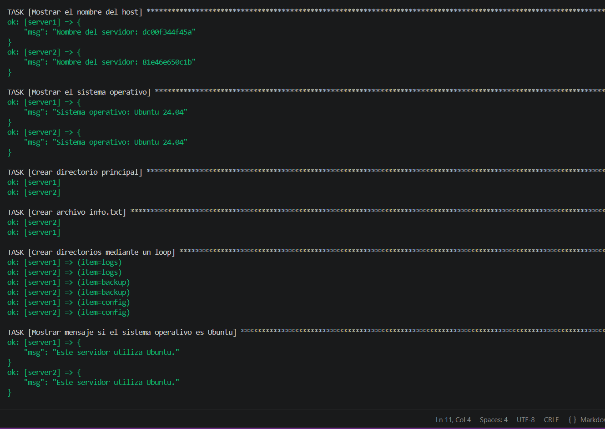

# Laboratorio de Ansible con Docker

## Objetivo de la práctica

Crear un laboratorio compuesto por dos servidores Linux utilizando Docker y administrarlos mediante Ansible. La práctica permite comprobar la conexión entre servidores y ejecutar tareas automatizadas mediante un Playbook.

## Iniciar los contenedores

```bash
docker compose up -d
```

## Ejecutar el Playbook

```bash
ansible-playbook -i inventory.ini playbook.yml
```

## Captura de pantalla de la ejecución exitosa

